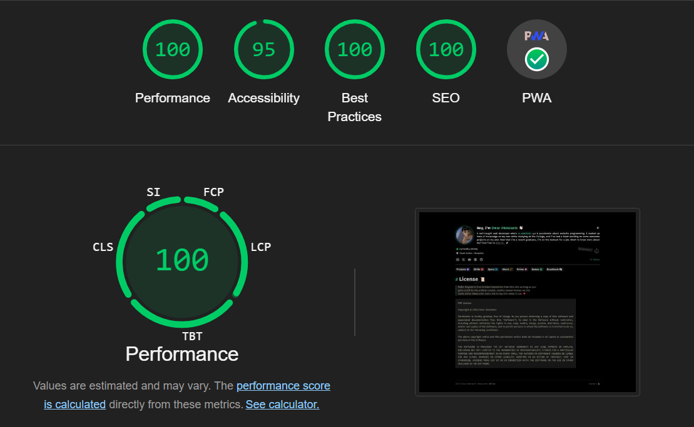
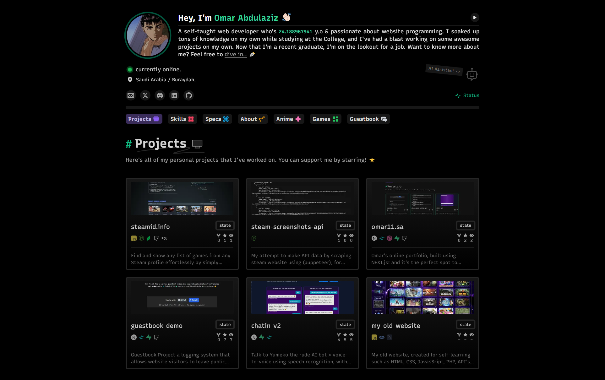
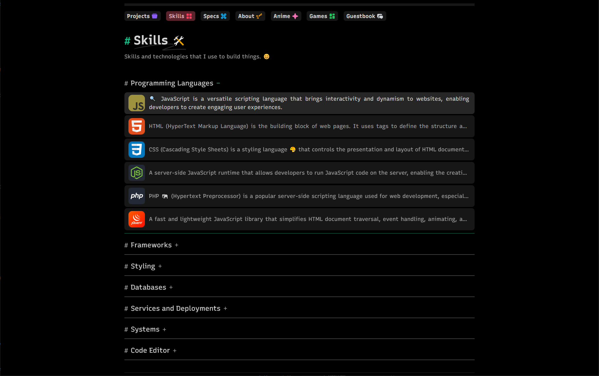
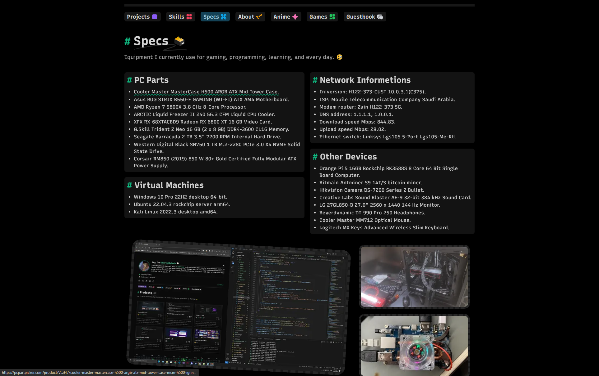
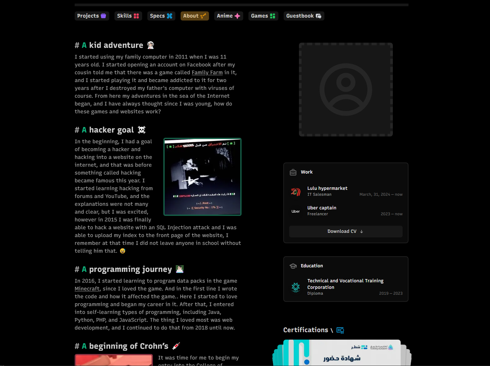
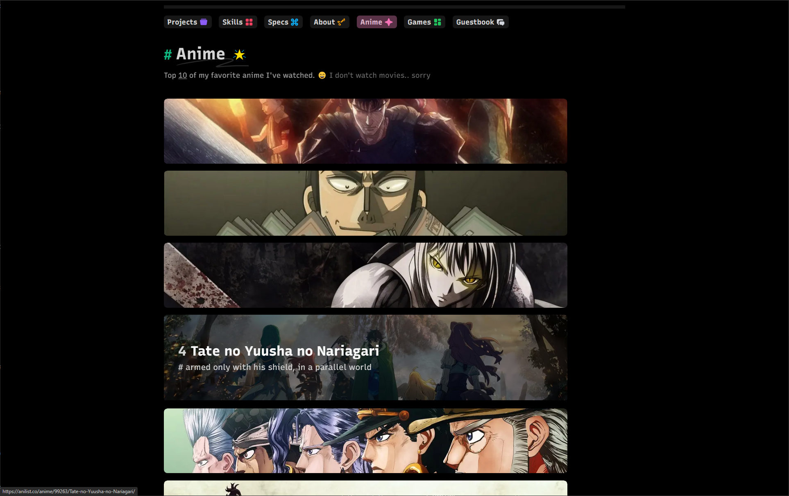
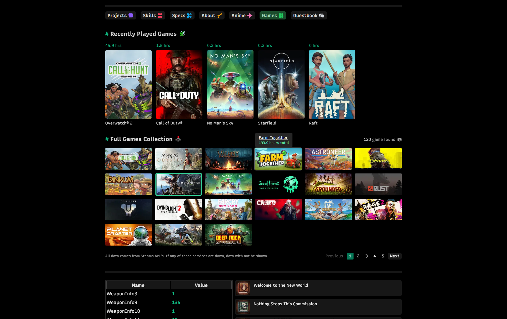
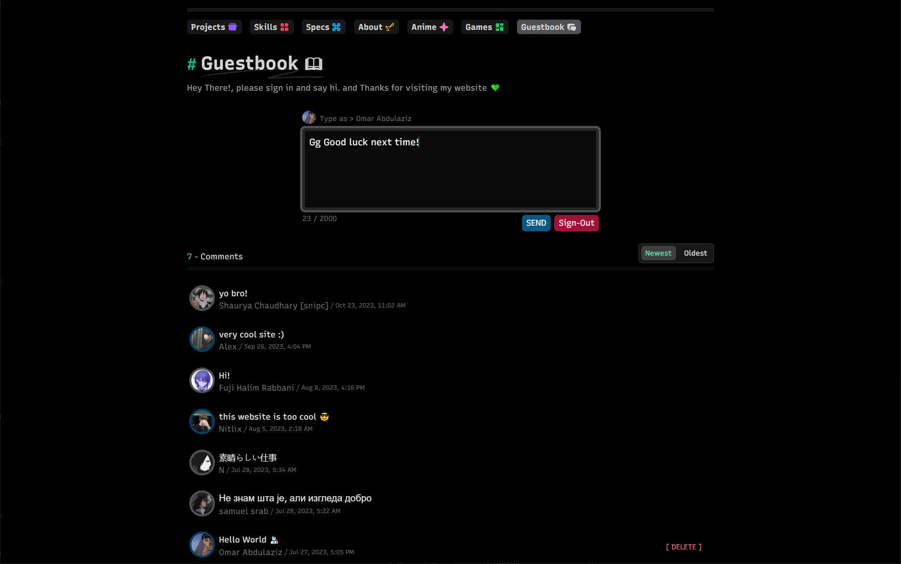
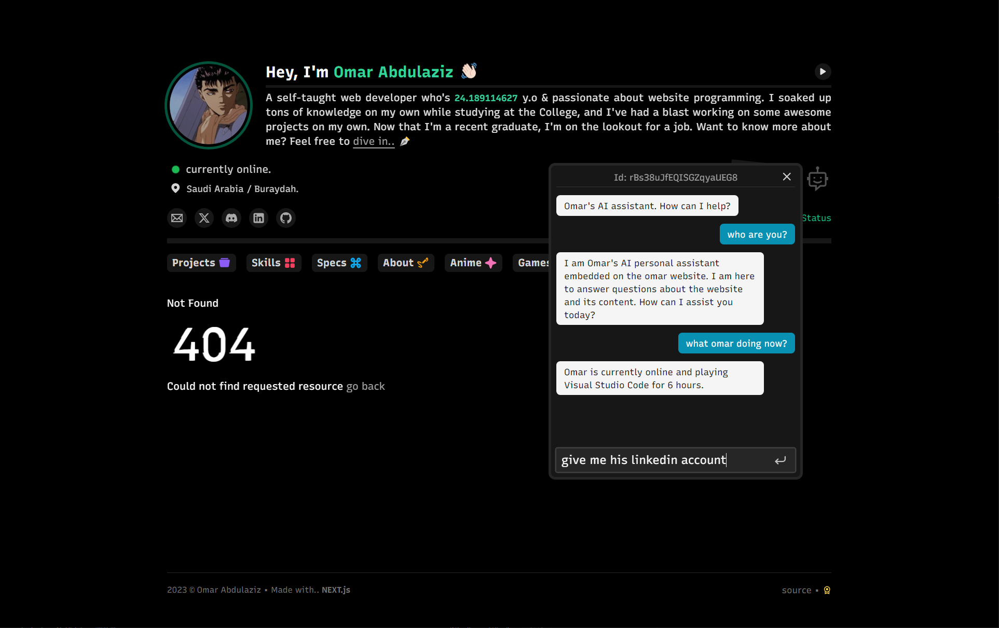

# [omar11.sa](https://omar11.sa/)


**Personal Website - Portfolio, Specs, Guestbook & more!**


[](https://www.codefactor.io/repository/github/omarx11/omar11.sa)


> ~ This is the complete source code for the <ins>omar11.sa</ins> website.

## Why did I build this website?

To show my programming skills, share my work, and give people a place to get to know me better. It may even help me land a great job.

After all, every programmer should have a place to showcase their achievements and work. 👌

## Performance

For this website.. Speed has been my main focus from the start. Pages are prerendered and served from the edge, data requests are cached, images are optimized and the JavaScript is kept small, so pages load fast while the UI stays smooth and animated.



## Features

- Fast and minimal: Server Components, Cache Components and Partial Prerendering.
- SEO-optimized, with a dynamic sitemap, Open Graph images and structured data.
- Guestbook: sign in with Google or GitHub and leave a comment.
- AI assistant that answers questions about the website and its content.
- Real-time Discord status from [Lanyard](https://github.com/Phineas/lanyard).
- Stats for every game I own, from Steam's APIs.
- My GitHub contributions calendar.

## Built with

| Name           | Link                                                  |
| -------------- | ----------------------------------------------------- |
| Framework      | [Next.js 16 (App Router)](https://nextjs.org/)        |
| Language       | [TypeScript](https://www.typescriptlang.org/)         |
| Styling        | [Tailwind CSS 4](https://tailwindcss.com/)            |
| Database       | [Neon Postgres](https://neon.com/)                    |
| Authentication | [Neon Auth](https://neon.com/docs/auth/overview)      |
| Linting        | [Biome](https://biomejs.dev/)                         |
| Deployment     | [Vercel](https://vercel.com/)                         |
| Icons          | [Iconify](https://icon-sets.iconify.design/)          |

## Screenshots

<table>
  <tr>
    <td align="center"><b>Projects</b><br /></td>
    <td align="center"><b>Skills</b><br /></td>
  </tr>
  <tr>
    <td align="center"><b>Specs</b><br /></td>
    <td align="center"><b>About</b><br /></td>
  </tr>
  <tr>
    <td align="center"><b>Anime</b><br /></td>
    <td align="center"><b>Games</b><br /></td>
  </tr>
  <tr>
    <td align="center"><b>Guestbook</b><br /></td>
    <td align="center"><b>AI assistant</b><br /></td>
  </tr>
</table>

## Local setup

1. Clone the repo and install the dependencies:

   ```sh
   git clone https://github.com/omarx11/omar11.sa.git
   cd omar11.sa
   npm install
   ```

2. Copy `.env.example` to `.env.local` and fill in the keys. The AI assistant
   is off by default (`AI_ASSISTANT_ENABLED="false"`), so you don't need a
   model server; its button then shows a "disabled" notice. To run your own,
   see [docs/ai-assistant-local-llm.md](docs/ai-assistant-local-llm.md).

3. Create the database tables:

   ```sh
   npm run db:migrate
   ```

4. Start the development server:

   ```sh
   npm run dev
   ```

To make it your own, edit `config/meta.ts` (your name, links and accounts) and the other files in `config/`.

## Deployment

Vercel builds Production from `main` only: `vercel.json` turns off deployments
for every other branch, so there are no Preview deployments. The project runs on
Node.js 24.x (`engines.node`), and its Production environment needs the keys in
`.env.example` (`DATABASE_*` come from the connected Neon store). Upload the
private files to Blob once with `npm run upload-private`.

> [!IMPORTANT]
> **Before you fork:** nothing in your copy may violate the sanctity of Islamic law, such as haram images or music. See the [LICENSE](LICENSE).

## License

[MIT with an additional condition](LICENSE) © Omar Abdulaziz

Give it a ⭐️ if this project helped you! Thank you.. 💚

<p align="right"><a href="#top">Back to top ↑</a></p>
